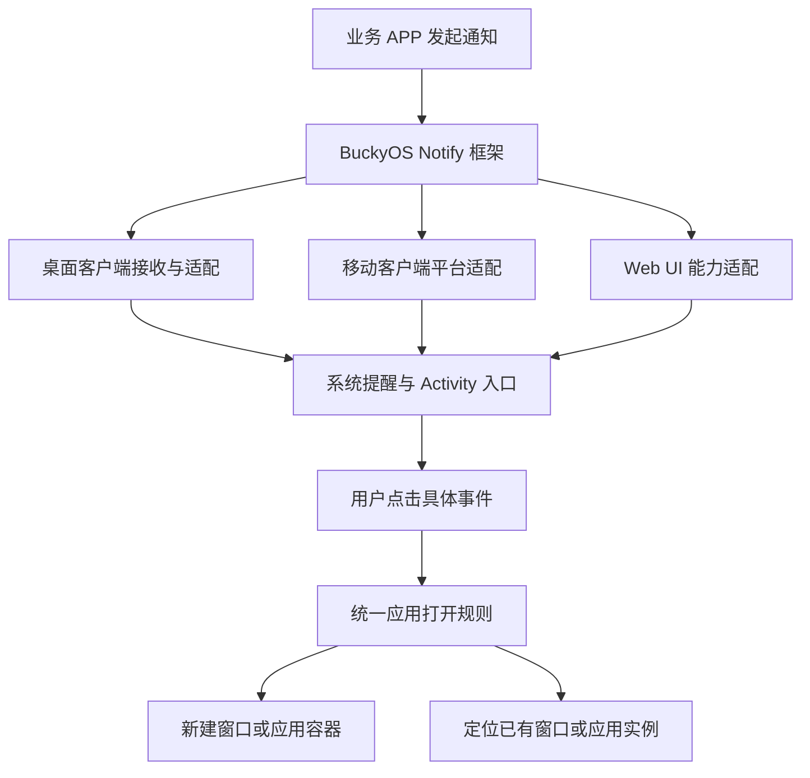

# BuckyOS APP 新版本系统设计

> 文档依据：本轮八段产品设计口述。  
> 文档定位：产品方向、系统职责与重构顺序的整合稿，供后续代码 Review 和详细设计使用。  
> 设计状态：区分已明确方向、当前倾向和待细化事项；具体接口名称、数据结构、平台实现及服务部署方式在后续设计中确定。

## 1. 产品背景与本次重构目标

### 1.1 从账号与绑定工具，演进为日常使用的系统客户端

过去的 BuckyOS APP 功能相对集中，主要承担三项职责：

1. 管理 BNS 账号。
2. 发现、激活和绑定 BuckyOS 设备。
3. 读取所绑定 Zone 上的应用列表，并启动应用。

在这一产品模型下，APP 主要区分“未绑定设备”和“已绑定设备”两种状态。完成绑定后，APPS 是最重要的功能入口。由于功能较为纯粹，桌面端与移动端可以采用基本一致的界面和交互。

新版本需要承接更丰富的日常使用场景：查看系统状态、使用不同 Zone 中的应用、接收消息与提醒、唤起应用窗口，以及持续播放或录制音频。

因此，本次重构的目标是：**让 BuckyOS APP 成为用户访问和使用 BuckyOS Zone 的常驻系统客户端，并为应用提供统一的终端能力。**

### 1.2 本版本桌面端先行，同时考虑移动端

过去的产品假设是移动端先行。当前的主要安装和引导路径决定了，本版本应以桌面端为先。

但 BuckyOS 仍然面向多个平台。每确定一项桌面功能、每设计一项面向应用的 Backend API，都应同时考虑其在移动端及 Web UI 中的对应方式。

本次重构尤其强调以下能力：

| 能力 | 产品价值 |
| --- | --- |
| 多 Zone 登录与切换 | 同一个 DID 可以在个人、公司、俱乐部等不同 Zone 中使用自己的权限和资源 |
| Notify 与 Activity | 用户不必一直打开各个应用网页，也能通过客户端接收重要消息并查看相关事件 |
| 窗口系统与应用容器 | 统一应用启动、已有窗口定位、跨应用跳转及不同终端的承载方式 |
| 后台音频 | 为持续音乐播放和录音提供系统能力，并考虑跨平台实现 |
| 两端主界面 | 根据桌面端和移动端的使用习惯，组织各自的高频入口 |

### 1.3 两条首次使用路径

#### 桌面版路径：本版本的主要入口

1. 用户安装 BuckyOS 桌面版。
2. 桌面出现 BuckyOS APP 图标。
3. 用户打开 APP，按照引导注册 BNS 账号。
4. 激活运行在本机 `127.0.0.1` 的 Desktop Service。
5. 完成相关绑定后，进入正常使用界面。

这条路径决定了用户首先接触的是桌面客户端，桌面端的首次体验和绑定后的 Home 都需要得到优先建设。

#### 小盒子路径：需要兼容的后续产品路线

1. 用户准备一台 Headless Linux 盒子，接通电源和网络并开机。
2. 在手机上安装 BuckyOS APP；当前口述以 Android APK 为例。
3. 在手机端完成 BNS 账号注册。
4. 扫描局域网内待激活的 BuckyOS 设备。
5. 完成盒子的激活与绑定。

这条路径不依赖 PC。桌面端先行的重构需要保留手机配合无头设备完成初始化的产品能力。

### 1.4 本文术语

| 术语 | 本文含义 |
| --- | --- |
| BuckyOS APP／客户端 | 用户安装在桌面或手机上的 BuckyOS 原生客户端 |
| 应用／业务 APP | 安装在 Zone 上、由客户端或 Web UI 打开和承载的应用，如 Message Hub |
| Zone | 用户访问应用、资源和服务的系统范围；可以是个人 Zone，也可以是组织的 Zone |
| 当前用户上下文 | 当前 Zone，以及当前 DID 在该 Zone 中的身份、权限和可访问资源 |
| BuckyOS API／SDK | 面向应用开发者的统一系统能力接口及配套 SDK |
| Backend API | 口述中的客户端底层能力接口；与 SDK 的具体边界由代码 Review 明确 |
| Notify | 应用发起通知、系统处理并将提醒触达到用户的能力 |
| Activity | 面向用户展示系统及应用相关事件的时间线界面 |
| Window System | 覆盖应用启动、窗口定位和不同环境应用容器的统一规则体系 |

语音中的 BuckyOS、Zone、Home 等不同转写在本文中统一。BuckyOS 客户端与业务 APP 的生命周期分别讨论。

## 2. 总体设计原则与四种运行环境

### 2.1 统一能力接口，保留必要的界面适配

应用开发者仍需要根据桌面端和移动端处理布局、导航和交互上的差异。

对于通知、应用启动、窗口定位、音频等系统能力，BuckyOS 应尽可能提供统一接口。尤其是应用运行在 BuckyOS 原生客户端内部时，平台差异应尽量由客户端处理。

应用还需要能够区分自己运行在普通浏览器中，还是运行在 BuckyOS APP 中，以便使用对应能力。

**统一的目标是尽可能一致的接口和操作语义。具体可用能力及表现形式，需要结合运行环境确定。**

### 2.2 四种环境共同纳入设计

| 运行环境 | 应用承载方式 | 设计关注点 |
| --- | --- | --- |
| 桌面 Web UI | 现有 BuckyOS Web UI 的窗口系统 | 将已有窗口机制纳入统一规则 |
| 桌面 APP | 原生系统窗口，内部承载网页内容 | 窗口创建、复用、配置及原生系统能力 |
| 移动 Web UI | 移动浏览器中的应用界面与容器 | 与浏览器导航区域协调，适配移动布局 |
| 移动 APP | BuckyOS APP 内相对独立的全屏应用界面 | 系统 Header、应用切换、最小化及移动系统能力 |

四种环境的窗口表现可以不同，但应用启动、定位和容器配置应保持连续性。所有业务 APP 的界面仍需要能够在浏览器中运行。

### 2.3 系统职责划分

以下是根据口述整理的职责边界，供详细设计使用，不代表已经确定的进程或服务拆分。

| 职责层次 | 主要责任 |
| --- | --- |
| 业务 APP | 处理业务、进行必要的界面适配、发起通知、请求启动目标应用或使用音频能力 |
| BuckyOS API／SDK | 向应用提供统一的系统能力入口，表达应用与系统之间的交互规则 |
| 系统公共框架 | 管理当前 Zone 上下文，协调通知、应用打开和窗口／容器规则 |
| 终端适配与系统 UI | 将公共规则落实为原生窗口、移动全屏容器、托盘、系统通知及各端界面 |

其中，多 Zone 是贯穿其他能力的基础上下文。通知指向哪个应用、应用使用哪个 Zone 的资源、用户在哪个范围内执行写操作，都需要与这一上下文协调。

## 3. 第一项基础工作：BuckyOS API 与现有代码 Review

### 3.1 Review 的目的

实施第一步是结合现有代码，梳理本次产品规划需要哪些底层能力：

- 哪些已经实现，可以直接使用。
- 哪些已有部分实现，需要补全或调整。
- 哪些尚未提供，需要新增。
- 哪些现有行为与多 Zone、原生窗口或移动容器的新要求存在冲突。

本轮口述提到后台音频已有部分开发基础、Web UI 已有窗口系统，但这些能力的具体实现范围仍需在代码 Review 中核实。

### 3.2 能力梳理范围

| 能力范围 | 需要回答的问题 |
| --- | --- |
| 运行环境识别 | 应用如何区分浏览器与 BuckyOS APP，并判断当前环境可用的系统能力 |
| Zone 上下文 | 如何表达当前 Zone、用户在该 Zone 中的身份，以及切换后的上下文 |
| Notify | 应用如何申请通知能力、发起通知，并交由系统触达用户 |
| Activity | 系统怎样提供事件展示及相关交互，如何与 Notify 配合 |
| 应用打开 | 如何通过统一规则打开应用、定位业务页面或唤起已有实例 |
| 窗口管理 | 单窗口、多窗口、Window ID、窗口配置和 URL 定位如何衔接 |
| 移动应用容器 | Header、返回、更多菜单、应用切换及最小化如何提供给应用 |
| 后台音频 | 播放、录音及可能的音频分发需要补充哪些能力 |
| 主题 | Zone 强调色如何与明暗主题及各端系统 UI 配合 |

Review 应形成能力清单、四种环境的支持情况，以及接口保留、调整或新增的建议，为后续模块设计提供依据。

**本文完成的是口述设计整合；代码 Review 属于接下来的实施工作。**

## 4. 多 Zone 基础框架

### 4.1 从单一绑定假设扩展到多 Zone 使用

过去的产品模型主要围绕“一个账号对应一个设备”展开。实际使用中，同一个用户已经可能拥有多个可登录的 Zone。

例如，用户既有自己的个人 Zone，也加入了公司或俱乐部。按照本次讨论中的系统设计，一个 Self-hosted Group 背后通常对应一个 Zone。

组织成员共同编写的文档和共享资料可能由组织拥有。组织 Zone 还可能安装一些个人 Zone 没有的应用，用于访问和处理组织资源。

因此，**同一个 DID 需要能够登录多个获得访问权限的 Zone，并在客户端中切换使用。**

设备激活、登录一个有权访问的 Zone、切换当前 Zone 是相关但不同的操作。用户访问组织 Zone，并不意味着需要重新激活组织的设备。

### 4.2 当前 Zone 是整个客户端的全局上下文

客户端中的内容应当基于：

**当前 Zone ＋ 当前 DID 在该 Zone 中的身份及权限。**

Zone 切换不是只替换 Home 上的应用列表。切换后，整个客户端各 Tab 都应进入目标 Zone 的用户上下文。

| 入口 | 切换 Zone 后的内容方向 |
| --- | --- |
| Home／APPS | 目标 Zone 的桌面、系统信息和当前用户可使用的应用 |
| Message Hub | 目标 Zone 下的消息与会话 |
| Home Station／Activity | 目标 Zone 下的社交动态或系统事件 |
| 快速创建“＋” | 在目标 Zone 中执行所选择的写操作 |
| Settings | 其涉及 Zone 的配置内容跟随当前上下文 |
| Library（后续） | 按全局上下文原则展示目标 Zone 下可访问的内容；具体界面在 Library 设计时展开 |

客户端本机设置、账号级设置与 Zone 设置如何分层，需要在详细设计中进一步区分。

### 4.3 切换入口与日常场景

在 Home 的当前账号区域提供 Zone 切换入口。

用户工作时，可以切换到公司或组织 Zone；处理私人事务时，再切换回个人 Zone。切换使用的是同一个 DID，但该 DID 在不同 Zone 中的职责、权限和资源范围可能不同。

当前更倾向于采用这种明确的上下文切换方式。此前考虑过的跨 Zone 内容聚合，容易让用户在执行操作时混淆当前范围。

这一选择主要服务于减少误操作，并不等于已经决定永久禁止所有跨 Zone 汇总能力。

### 4.4 Zone 主题色

鼓励每个 Zone 选择自己的主题色，用持续可见的局部颜色帮助用户识别当前上下文。

整体仍以浅色和深色两套基础色系为主。Zone 颜色主要用于小范围强调，例如 Tab 选中效果、指示线或 Home 的局部视觉元素。

设计重点是：用户即使使用同一个身份，也能够意识到自己目前是在个人、公司还是俱乐部的 Zone 中操作。

具体色值、配置权限、同步方式和组件应用范围，留待主题系统设计时明确。

### 4.5 与其他模块共同设计的边界

多 Zone 会影响通知、独立窗口和音频任务。以下行为尚未在口述中确定：

- 非当前 Zone 是否继续接收或弹出通知。
- 点击其他 Zone 的通知时，是否切换全局上下文。
- 切换 Zone 后，原 Zone 的已打开窗口或移动应用实例如何处理。
- 原 Zone 中正在播放、录音或尚未完成的写操作如何继续。
- Window ID、应用实例及状态记录如何区分所属 Zone。

这些问题应在多 Zone 与对应模块的联合设计中明确。当前已确定的是全客户端切换原则，尚未确定所有后台实例的处理规则。

## 5. Notify 与 Activity 框架

### 5.1 建设目标与范围

Notify 是本次重构的独立基础板块，需要从应用开发接口一直覆盖到用户最终看到的界面。

建设范围包括：

- SDK 与应用通知接口。
- BuckyOS Notify 权限。
- 系统对通知的处理和终端触达。
- 桌面端及移动端的通知适配。
- Activity 页面的产品定义。
- 用户点击通知后打开应用及定位业务页面的行为。

**业务 APP 负责在需要时发起通知，BuckyOS 负责处理不同终端的触达方式。**

应用开发者不需要分别为 Windows、macOS、Android 和 iOS 实现完整的通知投递机制。

### 5.2 主要通知来源

| 来源 | 口述中的典型场景 |
| --- | --- |
| Message Hub | 收到新消息 |
| AI Workspace | 有人参与工作空间协作、发表评论等 |
| Calendar | 日程达到预设提醒时间 |
| To-do | 待办事项提醒 |
| 系统及其他 APP | 各自业务逻辑产生的事件与提示 |

过去以 Web UI 为主，许多业务场景尚未补齐 Notify。新框架建设时，还需要各应用在相应业务逻辑中接入通知能力。

### 5.3 通知权限

按照当前产品方向：

- 系统 APP 具备相应的 BuckyOS Notify 权限。
- 普通 APP 需要先申请 BuckyOS Notify 权限。
- APP 通过 BuckyOS 提供的能力发起通知。

这里讨论的是 BuckyOS 自己的应用通知权限。它与宿主操作系统通知许可之间如何配合，由客户端的平台适配方案进一步定义。

### 5.4 Activity 的两种方案及当前倾向

| 方案 | 产品形态 | 优点 | 代价或约束 |
| --- | --- | --- | --- |
| 直接集成 Message Hub | 以会话列表为主要入口，点击后打开会话或对应应用 | 用户熟悉，也可以利用现有会话体系 | 其他类型的提示需要先接入 Message Hub 才能通过此入口呈现 |
| 独立 Activity | 按时间线展示不同来源的系统与应用事件 | 可以将事件与通知建设为更底层的系统能力，跳转到不同 APP | 需要新建 Activity 页面及相关能力 |

**当前更倾向于独立 Activity。**

这一方向的主要价值是，让系统事件不必依附于 Message Hub 的会话结构。Message Hub 是通知来源之一，也可以作为独立的完整应用被唤起。

Notify 侧重提醒触达，Activity 侧重事件展示。哪些事件进入 Activity、是否每条通知都形成一条时间线记录、历史保留和已读规则，仍需详细设计。

### 5.5 不同终端的通知触达

| 环境 | 本轮确定的设计方向 | 待细化内容 |
| --- | --- | --- |
| 桌面 APP | 与 Zone 保持 WebSocket 长连接，接收通知 | 连接恢复、状态处理及与系统通知的衔接 |
| Android APP | 由 BuckyOS Android 客户端处理平台通知和后台场景 | 具体机制与运行限制的适配 |
| iOS APP | 由 BuckyOS iOS 客户端处理通知，重点解决后台触达 | 平台通知方案及可能需要的配套能力 |
| Web UI | 根据浏览器支持的能力提供通知体验 | 可用能力及受限场景中的处理方式 |

Android 和 iOS 的具体推送服务、接口及基础设施没有在口述中定案。后续应结合平台要求和现有实现选择方案。

以下图示只表达职责关系，不表示服务部署结构：

事件是否进入 Activity、是否触发系统提醒以及如何复用应用实例，均需要对应模块给出具体规则。

### 5.6 桌面常驻、托盘与通知操作

桌面客户端可以作为一个竖长的小窗口常驻在屏幕旁，也可以结合系统托盘使用。

以 Windows 场景为例，本轮提出的交互方向包括：

- 收到通知后弹出提示。
- 托盘图标通过标记或闪动提示用户。
- 不同类型的通知可以采用不同提示效果。
- 双击托盘图标时，可以唤起最新一条提示对应的 APP 窗口。
- 点击 Activity 中的事件，打开对应 APP 并定位相关页面。

具体提醒样式、多个通知之间的优先级和托盘点击规则，仍需在交互设计中明确。

这里的核心能力是按事件来源打开不同应用。用户让 BuckyOS APP 常驻后，可以接收重要消息，无需保持各个业务应用的网页一直打开。

### 5.7 Message Hub 的定位

Message Hub 继续保持完整的单窗口应用形态，在一个窗口内组织社区或会话列表与内容区域。

系统通知负责提醒和唤起，Message Hub 负责自己的沟通业务。无需因为建设通知入口，就采用每个会话单独打开一个系统窗口的形态。

在移动端，Message Hub 另外拥有一级 Tab，具体见第 9 章。

## 6. Window System 与应用容器

### 6.1 统一解决“新建还是定位已有实例”

窗口系统的核心是统一应用之间的打开规则。

不论请求来自应用图标、Activity、系统通知还是其他 APP，都需要能够表达目标应用或页面，并由系统按统一规则决定：

- 创建一个新的窗口或应用实例。
- 定位并唤起已经存在的窗口或实例。
- 进入应用中的指定业务页面。

这一机制需要支持单窗口与多窗口应用，并引入 Window ID 等窗口标识概念。

本轮已经提出结合标准 BuckyOS URL 定位应用、页面或特定窗口。URL 格式、Window ID 的作用域，以及 URL 与窗口复用的具体映射规则尚待设计。

### 6.2 桌面 APP：原生窗口内承载网页

过去从 APPS 点击图标主要是拉起浏览器。新版本桌面客户端需要将应用承载在本地独立窗口中。

Windows 与 macOS 可以保持各自系统的窗口风格，窗口内部仍然是应用的网页内容。

应用应能够配置常见窗口属性，包括：

| 配置方向 | 要表达的能力 |
| --- | --- |
| 固定大小 | 应用可以选择固定尺寸的窗口 |
| 可调整大小 | 应用可以允许用户 resize |
| 最大化 | 配置是否提供最大化能力 |
| 最小化 | 配置是否提供最小化能力 |
| 单窗口或多窗口 | 表达应用的实例组织方式，并参与统一打开规则 |
| 窗口定位 | 利用窗口标识及 URL 定位目标窗口或页面 |

这些是需要覆盖的配置方向。配置放在哪里、怎样传给系统以及具体字段名称，应结合现有代码确定。

### 6.3 关闭与最小化的当前倾向

本段讨论的对象是被启动的业务 APP 窗口。

| 操作 | 当前版本倾向 |
| --- | --- |
| 最小化 | 窗口继续存在，可承载持续播放等任务 |
| 点击关闭按钮“×” | 按关闭当前网页 Tab 的语义处理，结束当前窗口的运行 |
| 再次点击应用图标 | 由统一规则决定新建窗口还是唤起已有窗口 |

例如，一个独立音乐播放器希望持续播放，应通过传统的窗口最小化来维持运行。

“点击关闭实际隐藏到后台”在不同平台上表现不同，本版本更倾向于保持关闭与最小化语义清楚。

BuckyOS 主客户端本身点“×”后是否进入托盘，以及用户退出整个客户端时如何处理应用窗口，未在本轮确定，应与业务 APP 的关闭行为分别设计。

### 6.4 移动 APP：相对独立的全屏容器

移动端通过 BuckyOS APP 内部的全屏应用界面承载业务 APP，整体参考微信小程序的使用方式。

基本交互为：

1. 用户从 BuckyOS Home 点击应用图标。
2. 进入该应用相对独立的全屏界面。
3. 从系统 Header 的应用切换入口，快速切换到其他已经打开的 APP。
4. 点击最小化按钮，返回 BuckyOS Home。

移动端最小化表达的是回到系统桌面。应用离开前台后如何继续执行任务，需要与各平台后台能力一起设计。

### 6.5 两种 Header 风格

| Header 风格 | 适用方向 | 定制边界 |
| --- | --- | --- |
| 透明／半透明 | 长内容流等适合透明系统栏的应用 | 在系统 Header 框架内定制，不追加第二行 Header |
| 固定底色 | 需要明确导航区或第二行功能区域的应用 | 承接第二行导航需求，具体布局由容器规范定义 |

有第二行需求的应用应选择固定底色风格。两种风格体现应用内容与导航需求的差异，应用可以在系统允许的范围内选择。

### 6.6 移动端系统 Header 元素

| 元素 | 职责 |
| --- | --- |
| 应用切换入口 | 快速切换已打开的 APP；口述也曾以头像式按钮描述，其最终视觉形态待定 |
| 返回按钮 | 可选，由应用定义相应返回行为 |
| 标题 | 显示应用或当前页面标题 |
| 搜索入口 | 标题附近可考虑提供，属于按应用需求选择的能力 |
| 更多菜单“···” | 放置应用自行定义的菜单操作 |
| 最小化按钮 | 返回 BuckyOS Home |

右侧由最小化和更多菜单承担系统退出当前前台界面与应用菜单的入口。具体尺寸、控件排列细节及动效不在本轮确定。

### 6.7 应用自身的 Footer 与导航

应用可以拥有自己的 Footer 或底部 Tab，这与系统级应用切换并不直接冲突。

但整体风格不鼓励应用设置过多底部 Tab。所有应用界面需要兼容浏览器，移动浏览器自身的底部导航区域也会占用空间。

因此，应用自己的功能导航通常优先放在顶部；需要第二行时，结合固定底色 Header 组织。

### 6.8 与 Web UI 窗口系统保持连续

现有 Web UI 已经有自己的窗口系统。重构应将它与原生窗口、移动容器共同纳入规划。

一致性重点包括：

- 打开一个应用的含义。
- 定位或复用已有实例的规则。
- 通过 URL 进入指定业务页面的方式。
- 应用能够声明的窗口或容器需求。
- 应用切换、最小化和关闭等操作的语义。

四种环境可以有不同的表现形式。具体哪些窗口配置适用、哪些能力需要转换或受限，应在 API Review 和容器详细设计中落实。

## 7. 后台音频能力

### 7.1 建设目标

后台音频是原生客户端的重要能力，包括持续播放和持续录音。

本轮提到，过去客户端已经做过部分相关能力，但尚未充分使用；现有 Web UI 也可以通过桌面上的音乐播放小部件持续播放。因此，新版本需要结合已有基础，明确原生窗口、Home 小部件和底层音频能力之间的关系。

### 7.2 两种音乐播放入口

| 形态 | 使用方式 | 与本次重构的关系 |
| --- | --- | --- |
| Home 音乐小部件 | 在 Home 中继续使用播放 Widget | 可以结合现有桌面内容的重新排布，纳入 Home 的定制 |
| 独立音乐播放器 | 打开应用窗口，通过最小化保持播放 | 依赖窗口承载和生命周期规则 |

本轮提出了这两种形态，具体 Widget 复用方式和两者的联动尚待展开。

### 7.3 后台播放

后台播放需要作为通用能力供多个应用使用，而非仅服务于一个特定播放器。

当前需求方向包括：

- 桌面应用窗口最小化后能够继续播放。
- 考虑多个 APP 同时播放音频的场景。
- 统一设计面向应用的能力接口。
- 在移动端利用相应平台的后台音频机制完成适配。

多应用音频之间的协调方式、平台受限时如何反馈，以及离开客户端后能持续到什么程度，需要进一步验证和设计。

### 7.4 后台录音与候选分发方案

部分应用可能需要持续记录声音。本轮提出了一种待研究方案：

1. 由 BuckyOS APP 统一承担底层录音。
2. 各业务 APP 申请使用录音能力。
3. 客户端按照应用的申请情况，将采集到的音频数据分发给相应 APP。
4. 对业务 APP 而言，表现为各自可以获得录音数据。

**统一采集并向多个 APP 分发是候选架构，尚未确定跨平台可行性。**

后续需要明确申请与权限、数据归属、并发使用和不同平台后台场景中的限制。是否采用此架构，应在验证后决定。

### 7.5 与窗口和多 Zone 的关系

后台音频设计需要结合两个边界：

- 窗口最小化、关闭以及客户端退出时，任务各自如何变化。
- 切换 Zone 后，原 Zone 中的播放或录音任务如何处理。

当前口述支持基于仍然存在的桌面窗口实现持续音频，并要求从一开始考虑移动端。关闭所有相关界面后的独立后台任务机制，尚未形成具体方案。

## 8. 桌面端信息架构

### 8.1 Home：可滚动的轻量桌面

完成 Zone 绑定或进入可使用的 Zone 后，Home 是默认页面。

本版本重点把已有的系统信息和应用入口组织起来，使 Home 成为一个可纵向滚动的轻量桌面。

主要内容包括：

- 原 Web UI 中的系统状态与日常监控面板。
- 应用启动入口。
- 用户可以添加的常用 APP 快捷方式。
- 当前账号区域，以及多 Zone 切换入口。
- 可考虑结合现有桌面重新排布的音乐播放等小部件。

当前用户区域也适合作为未来用户配置和 Settings 的进入位置；本版本可以先保留原有独立 Settings Tab。

### 8.2 桌面主要面板

下表说明各面板的职责，不冻结新增面板后的最终排列顺序。

| 面板 | 本版本方向 | 后续演进 |
| --- | --- | --- |
| Home | 系统面板、轻量桌面与常用应用入口 | 持续承担日常使用入口 |
| APPS | 保留为当前 Zone 全部应用的启动器 | 若 Home 已完整覆盖应用访问需求，可以考虑移除 |
| Activity | 按当前倾向新增独立事件时间线 | 与系统级 Notify、应用唤起配合 |
| Settings | 暂时保留独立 Tab | 后续可从 Home 当前用户配置入口进入 |

APPS 当前可以先保留占位，其最终必要性随 Home 的应用组织能力再评估。

### 8.3 日常桌面场景

桌面 BuckyOS APP 保持适合常驻的竖长面板形态。用户可以在旁边查看系统信息和动态，也可以配合托盘使用。

业务应用通过本地窗口打开。不同通知可以唤起不同 APP，Message Hub、音乐播放器或其他业务应用分别保留自己的界面。

这一组合将 Home、Notify、Activity 和窗口系统连接起来，使客户端可以在日常使用中持续发挥作用。

## 9. 移动端信息架构

### 9.1 主导航结构

移动端根据手机上的高频需求组织一级入口，不要求与桌面端 Tab 完全一致。

| 位置 | 当前版本入口 | 核心用途 |
| --- | --- | --- |
| 第一项 | Home | 延续现有桌面展示习惯，以应用启动为主 |
| 第二项 | Message Hub | 快速访问消息和会话 |
| 中央按钮 | ＋ | 弹出快速创建菜单 |
| 第四项 | Home Station／Activity | 默认查看社交动态，可切换全应用动态 |
| 最后一项 | Settings | 本版本保留，下一版本向 Library 演进 |

中央“＋”是动作入口，不是一个普通的内容页面 Tab。

### 9.2 Home：先延续已有习惯

移动端 Home 先延续现有 BuckyOS 桌面的展示和应用启动逻辑，并为移动客户端进行必要定制。

重新定义移动首屏曾被考虑，但当前倾向是先保持既有使用习惯。Home 在本版本主要承担 APP 启动器的职责。

### 9.3 Message Hub：必须便捷访问的一级入口

手机端快速访问 Message Hub 是非常重要的刚性需求，因此它直接占据一级 Tab。

用户无需先进入 Home 再寻找图标，即可访问消息与会话。

Message Hub 的一级 Tab 与从应用启动器打开它的入口是否复用同一实例，需要与移动容器规则一起明确。

### 9.4 中央“＋”：系统级快速写入

点击中央加号后弹出菜单，让用户直接选择要完成的操作。

口述中明确提出的示例包括：

- 快速发一条消息。
- 快速发布一条 Feed 动态。
- 快速添加一条笔记。
- 快速上传一张照片。

这一入口的目标是，让用户无需先找到并逐个打开具体 APP，就能完成一次常见的写操作。

在多 Zone 框架下，这些写操作需要处于当前 Zone 的用户上下文中。菜单操作如何交给对应应用处理，留待接口设计。

### 9.5 Home Station 与全部 Activity

移动端的动态入口默认展示 Home Station，优先满足用户查看社交动态的需求。

该入口同时提供切换能力：

1. 默认进入 Home Station 动态。
2. 从菜单进入“全部动态”。
3. 切换到与桌面类似的全应用 Activity 时间线。
4. 记忆用户选择的模式，并提供配置。

这里确定的是一个入口下的展示范围切换。Home Station Feed 与系统 Activity 是否共用数据模型、如何关联以及状态按什么范围保存，仍需详细设计。

### 9.6 Settings 与下一版本 Library

当前版本保留 Settings。

下一版本提出以 Library 替换这一主导航入口，作为内容展示和消费的综合入口。

| Library 内容 | 典型场景 |
| --- | --- |
| 最近内容与个人上传 | 快速找到近期上传或使用的媒体 |
| 个人内容库 | 照片库、音乐库及其他个人内容 |
| 已购和可消费内容 | 找到购买的电影、音乐等可使用的内容 |
| 内容商店推荐 | 发现新的可获取或购买内容 |

例如，用户刚购买了一部电影，之后可以从 Library 找到并观看。

产品形态参考口述中的 Steam 桌面版及 Apple Store 式商店界面，重点在于个人内容、已购内容、可消费内容和商店推荐的综合呈现。

口述中提出了 Settings 后续整体向 Library 演进的意向，但具体展开的是移动端。桌面端是否同步替换、导航放在哪里，以及 Settings 最终迁移的位置，需要在后续版本方案中明确。

## 10. 版本范围与实施顺序

### 10.1 已明确的基础建设顺序

| 顺序 | 基础板块 | 核心工作 |
| --- | --- | --- |
| 1 | BuckyOS API 与现有代码 Review | 核实已有能力，明确需要补全和新增的接口 |
| 2 | 多 Zone 框架 | 同一 DID 登录多个 Zone、全局上下文切换及主题色机制 |
| 3 | Notify 与 Activity 框架 | 从应用接口、SDK、客户端适配到最终通知和时间线 UI |
| 4 | Window System 与应用容器 | 统一应用打开规则，覆盖四种运行环境及其窗口／容器配置 |

这一顺序体现先梳理接口与底层上下文，再建设公共能力的重构思路。

后台音频、Home、两端主导航都属于本轮提出的工作范围，但口述尚未明确它们在上述四项之外的严格实施次序。实际安排应结合能力依赖和代码 Review 结果确定。

### 10.2 版本边界

| 分类 | 内容 |
| --- | --- |
| 本次重构的重点方向 | API 梳理、多 Zone、Notify／Activity、窗口与移动容器、后台音频能力、两端主界面调整 |
| 当前版本暂时保留 | 桌面 APPS、两端 Settings；移动 Home 继续沿用已有桌面和启动器习惯 |
| 当前倾向 | 独立 Activity；明确切换 Zone；业务 APP 关闭窗口与最小化采用不同语义 |
| 候选方案 | BuckyOS APP 统一采集录音并向多个 APP 分发 |
| 下一版本规划 | Library 作为内容消费入口，移动主导航以其替换 Settings |
| 后续再评估 | 是否移除桌面 APPS、Library 在桌面端的落点及同步节奏、Settings 的最终入口 |

### 10.3 模块之间的主要依赖

- **多 Zone → 其他模块：** 各 Tab、应用打开、通知及音频需要明确所属上下文。
- **Notify → 窗口系统：** 通知点击后的打开行为使用统一应用启动和定位规则。
- **窗口系统 → 音频：** 最小化、关闭和应用实例生命周期直接影响持续播放与录音。
- **移动容器 → 移动 UI：** 主导航、应用切换与业务 APP 自身的 Header／Footer 需要协调。
- **统一 API → 四种环境：** 各端表现差异通过能力适配处理，并保留面向应用的一致语义。

这些依赖用于后续拆分工作，不要求各模块只能串行开发。

## 11. 详细设计阶段需要收敛的问题

以下是根据本轮方向整理的后续设计清单，尚未形成具体实现决策。

| 主题 | 需要明确的问题 |
| --- | --- |
| 多 Zone 登录与状态 | 登录会话如何保存；账号级、客户端级和 Zone 级状态如何区分 |
| Zone 切换与现有实例 | 已打开窗口、移动实例、未完成操作及未保存内容如何处理 |
| 多 Zone 通知 | 非当前 Zone 是否接收通知；点击跨 Zone 通知时如何进入正确上下文 |
| Activity 与 Notify 关系 | 哪些事件进入时间线、哪些触发提醒；历史、已读及多端状态如何处理 |
| 通知可靠性 | 断线恢复、离线期间事件、重复提醒及投递失败如何处理 |
| 移动通知适配 | Android 与 iOS 分别采用什么机制，需要哪些配套能力 |
| 窗口定位 | Window ID 的作用域；单／多窗口规则；新建和复用的判断方式 |
| 标准 URL | 如何定位应用、业务页面或窗口，如何携带必要的 Zone 上下文 |
| 窗口配置 | 配置载体、字段、默认值及四种环境中的适用范围 |
| 主客户端生命周期 | 点“×”、进入托盘和退出客户端分别意味着什么 |
| 移动 Header 与导航 | 两种 Header 的细节，返回行为、搜索、应用切换入口和第二行布局 |
| 移动入口与应用实例 | Message Hub 一级 Tab、Home 图标和通知唤起是否使用同一个实例 |
| 后台播放 | 多应用并发、移动后台场景以及与窗口／Zone 切换的关系 |
| 后台录音 | 统一采集分发的可行性、申请与权限、并发使用和数据归属 |
| 跨环境能力差异 | 能力识别、不可用时的反馈，以及四种环境的适配行为 |
| 主题与显示偏好 | Zone 主题色与 Home Station／Activity 模式的配置和保存范围 |
| 导航后续演进 | APPS 是否删除，Library 的端别范围及 Settings 迁移位置 |

上述问题应在对应模块的设计中逐项落实，形成研发可执行的接口和交互约定。

## 12. 后续评审的检查场景

以下场景由本轮需求直接整理，用于验证后续方案是否覆盖目标，不代表已执行测试。

| 场景 | 需要验证的结果 |
| --- | --- |
| PC 首次安装 | 能从桌面图标进入注册、激活本地 Desktop Service 的流程 |
| 手机配合小盒子 | 不依赖 PC，完成账号注册、局域网发现和激活绑定 |
| 同一 DID 访问个人与组织 Zone | 进入各自有权使用的资源和应用，切换后各 Tab 使用正确上下文 |
| 收到消息、评论或日程提醒 | 通过统一 Notify 能力触达，并按事件来源进入相应应用 |
| 应用已经打开时再次进入 | 系统依照统一规则处理新建或复用，能定位所需业务页面 |
| 桌面音乐播放器最小化 | 持续播放行为与窗口生命周期约定一致 |
| 移动端打开和切换应用 | 进入全屏容器，能切换已打开应用，最小化后回到 Home |
| 从“＋”快速写入 | 能在当前 Zone 中完成消息、Feed、笔记或照片操作 |
| 移动动态视图切换 | 默认社交动态，可切全部动态，并按最终约定保存偏好 |
| 四种环境运行同一 APP | 界面适配各环境，公共能力的语义连续，受限行为有明确约定 |

## 13. 口述依据与内容对应

本文以用户原始口述为依据；此前逐段整理中额外推导的内容，不作为已经确认的实现决策。

| 口述段落 | 原始讨论重点 | 本文主要位置 |
| --- | --- | --- |
| 第一段 | 桌面安装与激活、小盒子路线、旧版账号／绑定／APPS、桌面先行 | 第 1 章 |
| 第二段 | 桌面 Home、APPS／Settings、独立 Activity 倾向、Notify、托盘、Message Hub 单窗口 | 第 5、8 章 |
| 第三段 | 本地应用窗口、关闭与最小化、Window ID／URL、后台播放与录音、跨平台考虑 | 第 6、7 章 |
| 第四段 | 移动全屏应用容器、两种 Header、应用切换、最小化、Footer／Tab | 第 6 章 |
| 第五段 | 移动主导航、中央“＋”、Home Station／Activity、下一版本 Library | 第 9 章 |
| 第六段 | API 与代码 Review 优先、多 Zone 全局切换、显式切换倾向、Zone 主题色 | 第 2、3、4、10 章 |
| 第七段 | Notify 独立板块、SDK 到 UI、桌面 WebSocket、移动平台适配职责 | 第 5、10 章 |
| 第八段 | 统一窗口规则、原生窗口配置、四种环境连续一致 | 第 2、6、10 章 |

第 11 章集中列出尚待收敛的系统边界，第 12 章将口述场景转换为后续评审检查项。

