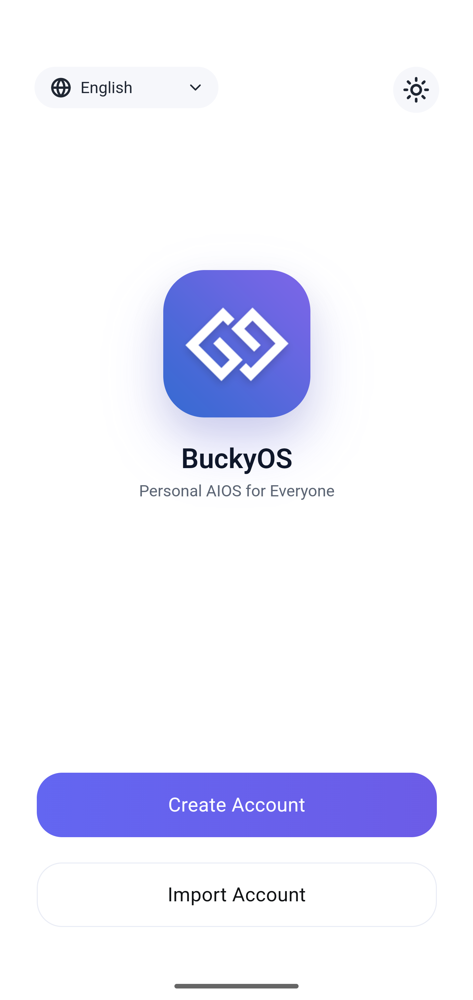
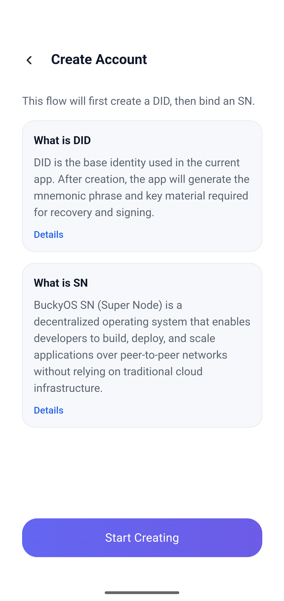
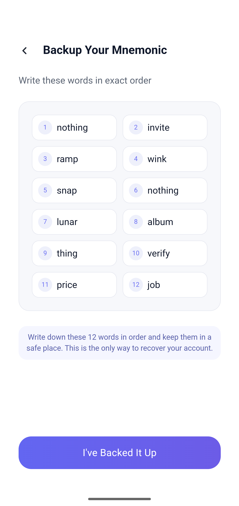
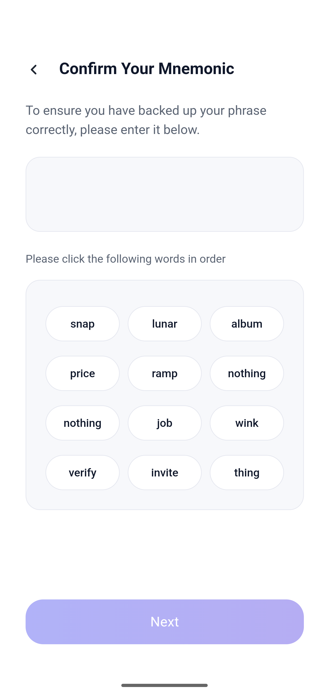
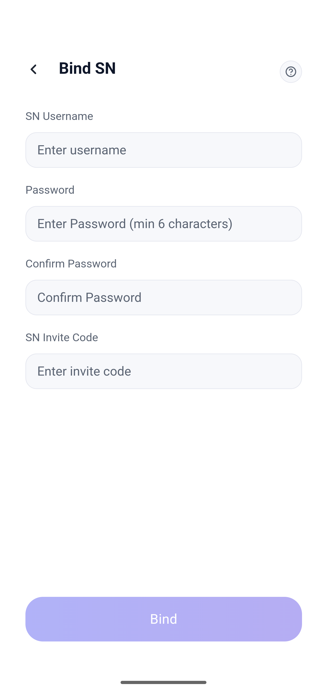
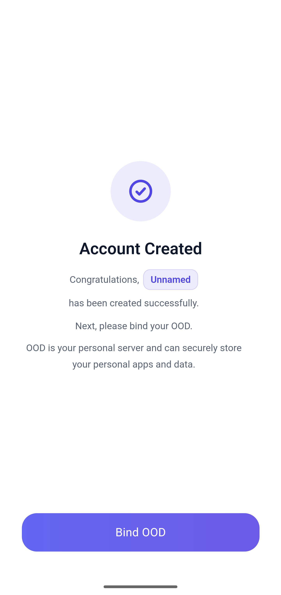
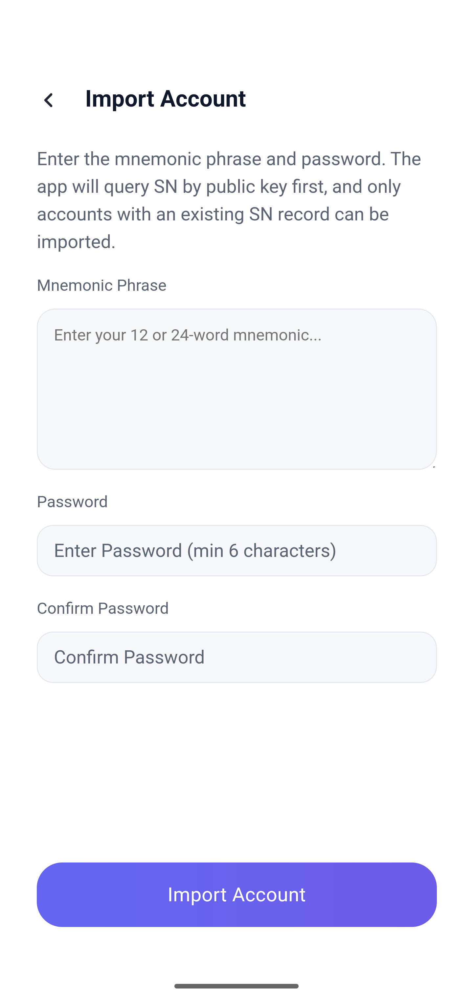
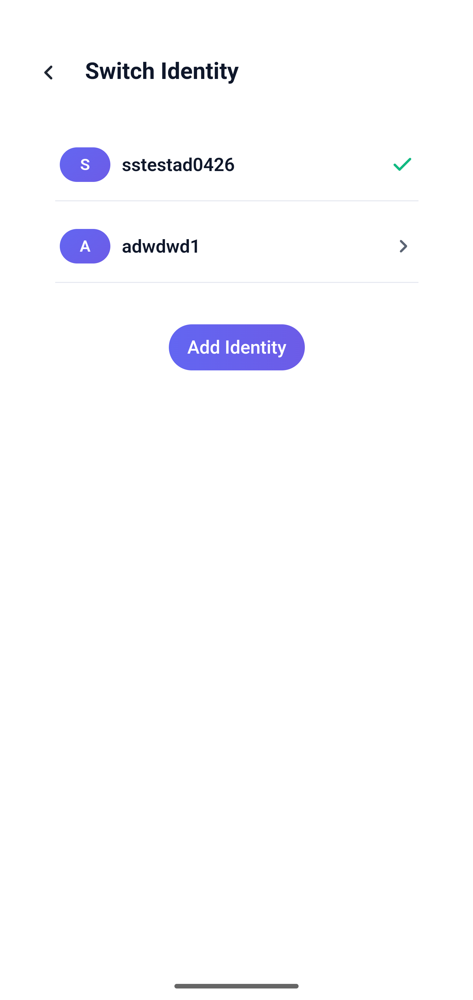
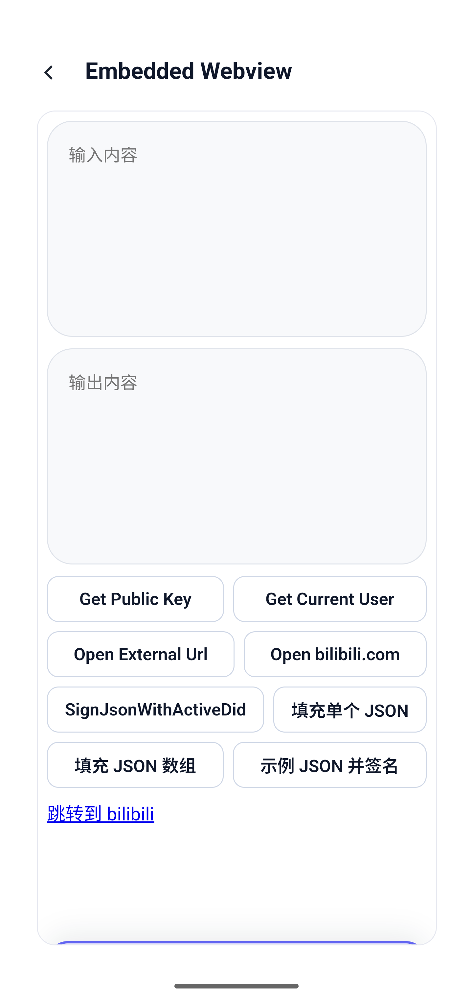

# BuckyOS App 当前需求文档

## 1. 文档说明

本文档只描述当前代码已经落地、已经在代码中明确体现，或已纳入当前版本实现范围的行为。目标态规划、尚未进入当前版本的页面和接口不作为验收范围。

当前项目是一个跨平台 App 项目，同一套产品能力需要同时支持 macOS、Windows、Android 和 iOS。本文档中未特别限定平台的功能要求，默认应在上述四个平台保持功能等价；平台差异会在对应章节单独说明。


## 2. 页面截图与说明

以下截图是账户流程改用新设计 token 之前的，只用来对照信息和入口。截图使用 Pixel 4 XL Android 模拟器，通过 `test-android-apps` 的 adb 截图流程采集。截图统一使用浅色主题和 English UI，来源为当前仓库前端和当前 Android WebView 容器。

| 页面 | 截图 |
| --- | --- |
| 欢迎页 |  |
| 创建账户说明页 |  |
| 助记词展示页 |  |
| 助记词确认页 |  |
| 绑定 SN 页 |  |
| 创建成功页 |  |
| 导入账户页 |  |
| 身份切换页 |  |
| 嵌入式 WebView 测试页 |  |

页面说明：

- 欢迎页提供创建账户和导入账户两个主入口，同时允许切换语言和主题。
- 创建账户说明页解释当前流程是先准备 DID 材料，再继续绑定 SN。
- 助记词展示页和确认页构成备份确认闭环。
- 绑定 SN 页收集 SN 用户名、统一密码和 Active Code，负责完成 SN 注册和 owner key 绑定。
- 导入账户页只收集助记词和统一密码，不再要求用户手动输入名字。
- 主窗口的四个 Tab（Home、Apps、Activity、Settings）见第 9 节。它们和 Zone 管理页、设备扫描页用 BuckyOS Desktop 的设计 token，旧截图不再适用，新截图待补。
- 嵌入式 WebView 测试页用于验证 `BuckyApi` 注入、宿主桥接和 iframe 输入框键盘避让。

## 3. 当前版本定位

BuckyOS App 当前承担三类职责：

- Zone 客户端：列出当前 DID 能用的 Zone，用保存的密码摘要登录，在本地界面显示当前 Zone 的状态、应用和动态，用独立窗口打开它的应用，接收系统通知。设计见 [buckyos app 新版本系统设计.md](./buckyos%20app%20新版本系统设计.md)。
- 身份宿主：管理本机 DID 的创建、导入、切换、备份、删除，以及 DID 维度的 SN 状态缓存。
- Runtime 宿主：为嵌入式 iframe 或独立 WebView 提供受控的宿主能力，并向页面注入 `window.BuckyApi`。

应用窗口以外的界面都由客户端自带，没有 Zone 时也能运行；应用窗口里显示的是 Zone 的页面。当前版本不是完整应用商店，也不是完整 OOD 生命周期管理器。

### 3.1 功能等价边界

本文档的目标不是要求源码级复刻，而是要求另一个实现能交付功能相同、数据兼容、协议兼容的 App。技术栈可以替换，但以下外部行为和兼容性边界必须保持一致：

- 路由和页面能力需要覆盖第 6 节列出的产品结构。
- DID、助记词、密钥、签名、加密、SN 密码摘要和本地持久化数据必须与第 10 节兼容，否则会影响账户恢复、SN 绑定、Runtime 签名和历史数据读取。
- SN 远端调用的方法名、参数、成功判定和轮询策略必须与第 11 节兼容，否则会影响创建、导入和 OOD 绑定状态判断。
- Runtime 对第三方页面暴露的 `window.BuckyApi` 能力和返回结构必须与第 12 节及 [BuckyApi.md](./BuckyApi.md) 兼容。
- Android 和 iOS 的安全区、键盘避让和 iframe 输入框避让必须达到第 13 节描述的用户可见效果。

当前代码的实现参考如下：

- 前端使用 React 单页应用、hash router、Vite。
- 宿主使用 Tauri 2，前端通过 Tauri `invoke` 调用 Rust 命令。
- 主 UI 运行在 Tauri WebView 中，移动端优先，同时支持桌面窗口。
- 前端使用 `buckyos` Web SDK 调用 SN JSON-RPC，并使用其中的 `buckyos.hashPassword`。
- Runtime 注入通过 Tauri 插件的 `js_init_script_on_all_frames` 覆盖所有 frame，注入脚本为 `public/bucky-api.js`。

### 3.2 UI 与状态约束

- 主题有跟随系统、浅色、深色三项，在设置页选择。浅色和深色保存到 `localStorage` 的 `buckyos.theme`，跟随系统时没有这一项。客户端的所有窗口一起变化。
- 样式用 BuckyOS Desktop 的设计 token（`@buckyos-desktop/tokens.css`，同一份文件）。Zone 主题色只标在 Tab 选中线、账号区、已打开应用的角标和未读点上，用户没有设置时用品牌蓝。
- 默认语言可跟随系统语言；用户可在设置页切换，结果保存到 `localStorage` 的 `buckyos.locale`。
- 当前支持语言包括 English、简体中文、繁体中文、西班牙语、法语、德语、韩语、日语、俄语。
- DID 创建流程中的密码、确认密码、助记词、助记词确认顺序、SN 用户名、Active Code、创建结果均为前端内存状态，流程未完成前不持久化。
- 直接刷新或从中间路由重新进入创建流程时，不要求恢复未完成的创建状态。
- 按钮、底部操作区、TabBar 和输入控件必须适配 Android 安全区和键盘 inset，约束见第 13 节。

## 4. 功能范围

### 4.1 已实现范围

- 欢迎页，提供创建账户和导入账户入口。
- DID 说明页。
- 创建账户说明页。
- 助记词生成、展示、确认。
- 创建流程中的 SN 绑定。
- 创建成功页，并引导进入 OOD 激活入口。
- 导入 DID，并在导入前通过公钥查询 SN 记录。
- DID 列表、身份切换。
- 身份备份。
- 身份删除。
- SN 状态持久化缓存。
- OOD 局域网扫描。
- OOD 手动地址输入激活。
- OOD 激活页打开。
- 在 Zone 管理页解绑自己的 Zone。
- 多 Zone：名单、切换、登录、管理、主题色（第 9.1、9.6、9.7 节）。
- Home、Apps、Activity、Settings 四个 Tab（第 9 节）。
- 系统通知和托盘（第 9.11 节，[托盘图标需求.md](./托盘图标需求.md)）。
- 用独立窗口打开当前 Zone 的应用。
- 关于页。
- 嵌入式 WebView 测试页（开发环境）。
- 设备激活页：桌面端是 `act_` 前缀的独立窗口，窗口里直接是设备的页面；移动端是一个原生视图，由 `/activation` 页面摆放。
- `BuckyApi` 注入与宿主能力桥接。
- Android 和 iOS 的安全区和键盘避让，包括同源 iframe 的输入框避让。

### 4.2 当前不在范围

- App 安装、升级、卸载。
- 完整的应用商店运营能力。
- 完整的 OOD 生命周期管理。
- 基于激活码、中继服务、二维码配对或账号云端发现的远程 OOD 激活。
- OOD 激活完成后的全部本地配置写回编排。
- 更细粒度的第三方页面权限授权体系。
- 超出当前宿主桥接能力之外的新 `BuckyApi` 接口。

## 5. 核心术语

- DID：本地身份对象，由助记词派生，包含钱包、公钥、昵称等信息。
- Active DID：当前激活身份。主应用展示、签名、Runtime API 均以它为准。
- Bucky Wallet：DID 下的 Bucky 钱包，当前默认使用第一枚钱包作为 SN 查询、身份展示和签名入口。
- SN：与用户名注册、邀请码校验、公钥查人、zone 信息查询相关的远端服务。
- SN 用户名：SN/BNS 体系中的正式身份名。当前创建流程使用它作为本地 DID 昵称。
- Active Code：SN 创建流程的邀请码，用于当前阶段的开户注册控制。
- OOD：用户设备节点。当前版本主要负责局域网扫描、手动输入远程地址、打开激活页、读取和解绑 zone 绑定状态。
- Runtime：宿主提供给 Web 页面的运行容器，包含嵌入式 iframe 和独立 WebView。
- `BuckyApi`：注入到第三方页面中的宿主 JS API。详细集成说明见 [BuckyApi.md](./BuckyApi.md)。

## 6. 产品结构

### 6.1 路由

DID 流程：

- `/`：欢迎页
- `/did-info`：DID 说明页
- `/sn`：SN 说明页
- `/import`：导入账户
- `/create`：创建账户说明页
- `/show-mnemonic`：展示助记词
- `/confirm-mnemonic`：确认助记词
- `/bind-sn`：绑定 SN
- `/success`：创建成功页

主应用流程（主窗口）：

- `/main/home`：Home；没有 Zone 时是设备激活和添加 Zone 的入口；移动端是应用启动器
- `/main/messagehub`、`/main/feed`：移动端的 Message Hub Tab 和动态 Tab
- `/main/home/ood-scan`：设备扫描页
- `/main/apps`：当前 Zone 的应用（仅桌面）
- `/main/activity`：当前 Zone 的动态（仅桌面，移动端在动态 Tab 里）
- `/main/setting`：设置页
- `/main/setting/zones`：Zone 列表
- `/main/setting/zones/add`：添加 Zone
- `/main/setting/zones/:zone`：一个 Zone 的设置，参数是编码后的 Zone DID
- `/main/setting/identities`：身份切换页
- `/main/setting/backup`：身份备份页
- `/main/setting/about`：关于页
- `/activation`：摆放设备激活页的原生视图（Android）
- `/web-container`：iframe 容器（开发环境的测试页）

其它窗口各只有一个页面，不运行客户端的运行时：

| 窗口 label | 路由 | 内容 |
| --- | --- | --- |
| `app_*` | `/content-status` | 应用窗口在页面加载中或打不开时显示的状态页 |
| `aux_sign_*` | `/prompt/sign` | 签名时输入钱包密码 |
| `aux_tray` | `/tray-popover` | 托盘图标旁的通知小窗 |
| `act_*` | 设备的页面 | 设备激活页，不是本地页面 |

### 6.2 TabBar 规则

桌面四个 Tab：Home、Apps、Activity、Settings。TabBar 只在 `/main`、`/main/home`、`/main/apps`、`/main/activity`、`/main/setting` 显示，二级页不显示。Activity 上的数字是当前 Zone 的未处理通知数加未读消息数。

移动端五项：Home、Message Hub、＋、动态、Settings，见第 9.12 节。Message Hub 上的数字是未读消息数，动态上的数字是未处理通知数。

### 6.3 启动规则

- 启动时如果本地不存在 DID，进入 DID 流程。
- 启动时如果本地已存在 DID，进入主应用流程。
- 如果本地有 DID 但没有 Active DID，主应用强制跳转到身份切换页。

## 7. DID 与 SN 创建流程

### 7.1 当前创建流程定义

当前代码采用“两阶段创建”的产品节奏，但本地 DID 的落盘时机以代码为准：

1. 生成助记词。
2. 用户确认助记词。
3. 输入 SN 用户名、密码、确认密码、Active Code。
4. 完成 SN 注册和 owner key 绑定。
5. SN 绑定确认后，才调用 `create_did` 创建本地 DID。
6. 创建出的 DID 自动成为 Active DID。

这意味着当前版本中：

- “点击创建账户”不会立刻创建本地 DID。
- 助记词确认后仍不是账户完成态。
- 只有 SN 注册、owner key 绑定、SN 记录可查询、本地 DID 创建全部完成后，创建流程才完成。
- 创建流程中途退出视为放弃本次未完成流程，不保留恢复继续创建态。

### 7.2 创建账户说明页

页面目标：

- 解释当前流程会先准备 DID 材料，再完成 SN 绑定，最终创建本地 DID。
- 告诉用户 DID 是本地身份，SN 是体系内可识别的名字。
- 不要求用户在本页输入昵称或密码。

当前页面行为：

- 展示 DID 说明卡片。
- 展示 SN 说明卡片。
- DID 卡片可进入 DID 说明页。
- SN 卡片可打开 `https://sn.buckyos.ai/`。
- 点击主按钮后生成助记词并进入助记词展示页。

### 7.3 助记词展示页

页面目标：

- 展示 12 个助记词。
- 明确提示用户离线备份。
- 强调助记词是恢复账户的关键材料。

要求：

- 固定顺序展示。
- 不弱化备份风险。
- 点击确认后进入助记词确认页。

### 7.4 助记词确认页

页面目标：

- 确认用户已经真实完成备份。

当前交互：

- 将助记词打乱形成词池。
- 用户按顺序点击单词。
- 顺序完全一致后，允许进入 SN 绑定页。

### 7.5 绑定 SN 页

页面目标：

- 承接创建流程第二阶段。
- 设置统一密码。
- 注册 SN 用户名。
- 使用 Active Code 完成当前阶段的创建准入。

输入项：

- SN 用户名
- 密码
- 确认密码
- SN 邀请码

本地校验规则：

- 用户名输入会先 `trim`，并统一转为小写。
- 用户名必须匹配正则 `^[a-z][a-z0-9-]{5,}[a-z0-9]$`。
- 用户名长度至少 7。
- 用户名首字符必须是小写英文字母。
- 用户名中间字符只允许小写英文字母、数字和连字符 `-`。
- 用户名末字符必须是小写英文字母或数字。
- 当前代码不允许点号 `.`，也没有连续点号规则。
- 密码长度至少 6。
- 两次密码必须一致。
- Active Code 必填。

远端前置检查：

- 用户名输入后延迟 500ms 调用 `auth.check_username`。
- Active Code 输入后延迟 500ms 调用 `auth.check_active_code`。
- 提交按钮只有在用户名远端检查成功、Active Code 远端检查成功、密码满足规则时才可用。

提交顺序：

1. 再次执行本地校验。
2. 调用 `derive_bucky_public_key` 根据助记词派生 Bucky 公钥。
3. 使用 `buckyos.hashPassword(username, password)` 生成 `pwd_hash`。
4. 调用 `auth.register` 注册 SN 用户名。
5. 调用 `user.bind_owner_key` 绑定 owner 公钥。
6. 轮询 `device.get_by_pk`，直到 SN 记录可见或超时。
7. 调用 `create_did` 创建本地 DID，昵称使用 SN 用户名，密码使用本页输入的统一密码。
8. 按 DID 维度写入 SN 状态缓存。
9. 进入创建成功页。

当前版本没有独立的“绑定确认页”。临时流程文档中提到的 DID Document 绑定语义，在当前代码中通过 `user.bind_owner_key` 和 `device.get_by_pk` 的结果确认体现。

### 7.6 创建成功页

页面目标：

- 告知账户已创建成功。
- 展示 DID 关键信息。
- 引导用户进入 OOD 激活入口。

当前展示：

- 昵称
- BuckyOS DID
- BTC 地址，如果存在
- ETH 地址，如果存在

主按钮行为：

- 进入 `/main/home`。

## 8. 导入 DID 流程

### 8.1 流程目标

导入 DID 用于恢复一个已经完成过 SN 绑定的身份。

导入成功后，系统应实现：

- 使用助记词恢复本地 DID。
- 根据派生出的 Bucky 公钥查询 SN 记录。
- 如果 SN 上存在记录，则使用 SN 返回的用户名作为本地 DID 昵称。
- 导入完成后自动设为 Active DID。

### 8.2 输入项

- 助记词
- 密码
- 确认密码

当前版本不包含：

- 手动输入昵称
- 手动输入 SN 用户名

### 8.3 校验与导入顺序

1. 输入过程中调用 `validate_mnemonic_words` 检查已完成单词是否合法；如果当前输入以空格结尾，检查全部单词，否则检查最后一个仍在输入中的单词之前的内容。
2. 提交时检查助记词非空、密码长度、两次密码一致。
3. 调用 `derive_bucky_public_key` 派生 Bucky 公钥。
4. 调用 `device.get_by_pk` 查询 SN 记录。
5. 如果未查到有效 `user_name`，导入失败。
6. 如果查到 `user_name`，使用该名字作为昵称调用 `import_did`。
7. 导入后刷新该 DID 的 SN 状态缓存。
8. 进入 `/main/home`。

结论：

- 导入 DID 不再要求用户手动输入名字。
- 只有 SN 上存在记录的 DID 才允许导入。
- 同一设备内不允许重复导入同一个 DID。
- 最终导入校验以 Rust `Mnemonic::parse_in(Language::English, phrase)` 为准，会校验 BIP-39 单词数量和 checksum；UI 上不单独要求输入 12 个词或 24 个词。

## 9. 主应用需求

### 9.1 Home

从上到下：

1. **账号区**：头像、身份名、当前 Zone 的名称、主题色和会话状态。点开是 Zone 列表（图标、名称、会话状态），点选切换当前 Zone；下面是“添加 Zone”和“管理 Zone”。桌面端切换不关闭已打开的应用窗口，正在播放音乐（第 4 项）时先询问；移动端先询问并关闭原 Zone 的应用。选中的 Zone 需要密码时直接弹出登录框。
2. **会话提示**：需要密码、已退出时有“登录”，连接不上、时钟不准时有“重试”。当前 Zone 连接不上时，每 30 秒和网络恢复时自动重试。
3. **系统状态**：`system.metrics`（CPU、内存、存储、收发速度、运行时间），页面可见时每 10 秒读一次。Zone 没有这个接口时显示需要升级；没有权限时不显示。
4. **音乐**：播放当前 Zone 里一个文件夹（含最多 3 层子文件夹，最多 2000 首）的音频，按文件夹顺序或随机。文件夹用本地的选择框选，从用户自己的 `/home/<用户>` 起逐级进入。文件夹、顺序和播放位置按 Zone 和用户存在本机；启动和切回来时停在上次的位置，不自动播放。换 Tab、隐藏主窗口不影响播放；切换 Zone 时停止（正在播放时先询问）；Zone 的会话不是已登录时暂停并显示会话状态，恢复后由用户继续。媒体键和系统媒体控制可用。音频由主窗口经 `zonemedia` 自定义协议读取，凭据不进页面。桌面端总有这张卡片；移动端选过文件夹才有，没选过时入口是搜索框右边的按钮。
5. **常用应用**：可以添加、移除、拖动排序（编辑状态下也可以用方向键和 Delete），点击打开。列表是该 Zone 账号桌面状态 `client_home` 的 `shortcuts`（应用 id，有序），跨设备一致；从没设置过时用 Message Hub、Home Station、AI Workspace、Files。已有窗口的应用图标上有角标。读到账号里的列表之前显示缺省的四个，不能编辑。

状态、应用目录、快捷方式、动态和音乐文件夹读取失败时自动重读：3、6、12、30 秒后，以及页面重新可见、窗口得到焦点、网络恢复、会话恢复时。

没有 Zone 时，账号区下面是两块：激活设备（桌面端自动探测 `http://127.0.0.1:3182/device`，有等待激活的本机服务就给出“激活”；另有查找设备、输入地址），以及添加能登录的 Zone。

### 9.2 设备扫描与激活

- 桌面端先探测本机 `127.0.0.1`，同时读 `local_ipv4_list`，扫描这些地址所在的 /24 网段，按批调用 `scan_device_batch`，只保留返回了有效 `active_url` 的设备。
- 局域网扫描不含 `127.*`；同时存在非 `172.*` 地址时排除 `172.*`。
- 本机排最前。同一台设备既从回环地址又从局域网地址发现时只留回环那一条。
- 激活地址：`active_url` 是完整 `http(s)` 地址就用它，否则拼成 `http://{127.0.0.1 | display_ip | ip}:3182/{path}`；`lang` 查询参数设为客户端语言，保留其它参数和片段。
- 由 `activation_open` 打开：桌面端是 `act_*` 窗口，同一设备复用；移动端是原生视图；只有打开时的那个源能留在里面并使用钱包方法，其它地址交给系统浏览器（名单内 Zone 的地址由客户端打开）。切换身份会关掉它。移动端的激活页打不开时显示原因和“重试”。
- 打开激活页之后，客户端每 5 秒重新读 owner 文档，窗口关闭后再读 2 分钟。出现新的 Zone 时：设为当前 Zone、用钱包密码摘要登录（新 Zone 还没启动完就继续重试约 3 分钟）、主窗口回到 Home。移动端不打断激活页，页头出现“完成”，离开后回到 Home。

### 9.3 远程设备地址

在“输入地址”对话框里选择协议（`http://` 或 `https://`，默认 `http://`）并填写 host 和可选端口：

- 支持域名、域名加端口、IPv4、IPv4 加端口；没有端口时用 `3182`；端口是 1 到 65535 的整数。
- 地址里不能带协议、路径、查询参数或片段，分别给出提示。
- 确认后请求 `{base}/device`（5 秒超时），有有效 `active_url` 才打开激活页，之后与 9.2 相同；失败时对话框保持打开并提示。

### 9.4 Apps 与 Activity

**Apps**：当前 Zone 里当前用户可用的全部应用，来自 `apps.list` 和 `https://<zone>/system-apps.json`，先显示已知的再刷新。搜索按各语言的名称和应用 id。点击交给打开规则；右键菜单可以打开、添加到首页或从首页移除。Zone 没有系统应用清单时提示需要升级，其余应用照常显示。

**Activity**：当前 Zone 的通知（全部状态，翻页）、有未读的会话（每个一行）、带系统通知标记的任务，按时间倒序、按天分组。归并逻辑和 Shell 用同一份源码。

- 点击一行打开对应的页面；打开一条未处理的 `notice` 同时标为已读。
- 单条操作：会话和 `notice` 标为已读，等待回复的通知可以忽略，已结束的任务可以从本机列表拿掉（按 Zone 和用户存在 `localStorage`）。“全部标为已读”不动等待回复的通知。
- 收到 `notify://changed` 时重读对应部分；修改之后通知 Rust 侧刷新计数。
- 通知连接断开重连、需要登录时在列表上方说明。

### 9.5 设置页

| 分组 | 内容 |
| --- | --- |
| 通用 | 语言（9 种）、主题（跟随系统、浅色、深色） |
| Zone | 管理 Zone；“<当前 Zone> 的设置”，用应用窗口打开系统应用 `settings` |
| 通知 | 总开关、每个 Zone 的开关；系统不允许显示通知时说明去系统设置里打开。第一次有登录成功的 Zone 时申请一次系统许可 |
| 本机（桌面） | 开机启动（autostart 插件）、托盘图标 |
| 身份 | 切换身份、备份身份、删除账户（先确认再输密码） |
| 其它 | 关于；开发环境有嵌入式 WebView 测试页 |

### 9.6 添加 Zone 与登录

- 添加：填 Zone 的地址或 DID、用户名、密码。先用 `zone_probe` 确认是哪个 Zone，再登录，登录成功才进名单并成为当前 Zone。页面写明要用这个 Zone 的用户名和密码，联合登录和 Google 登录的账号暂不能用客户端。
- 登录框：Zone 需要密码时由会话提示、打开应用、应用窗口状态页的“登录”弹出。用户名预填上次的；自己的 Zone 预填身份名。
- 失败原因分开说明：地址不对、那里没有 Zone、连不上、用户名或密码错、账号没有密码、时钟不准、Zone 拒绝这个账号。
- 任何地方都不显示 Zone 的登录网页。

### 9.7 Zone 管理

列表显示每个 Zone 的图标、名称、会话状态。单个 Zone 的页面：地址、DID（可复制）、用户、来源；主题色（写该 Zone 账号外观状态的 `accent`，再更新本机记录）；通知开关；重新登录、重新连接、退出登录、从列表移除。来自 owner 文档的 Zone 另有“解绑”：确认、输钱包密码、签名并调用 SN 的 `owner.remove_bound_zone`、等 owner 文档更新，然后重读名单。退出、移除、解绑之前先逐个询问这个 Zone 的应用窗口，有一个不同意关闭就停止；切换或删除身份之前询问全部应用窗口，之后它们全部关闭。退出登录后不会再自动登录，直到用户自己登录；用另一个用户名登录同一个 Zone 会清掉之前的 Cookie 和窗口。

移除只是从名单隐藏；自己的 Zone 可以用地址重新添加。

### 9.8 身份切换页

页面目标：

- 展示全部 DID。
- 允许切换 Active DID。
- 提供添加身份入口。

当前规则：

- 当前激活身份显示选中态。
- 点击非当前身份后弹出密码框。
- 使用 `reveal_mnemonic` 作为密码校验。
- 校验通过后调用 `set_active_did`。
- 底部添加身份弹窗提供“创建账户”和“导入账户”。

### 9.9 身份备份页

进入前置条件：

- 从设置页输入密码，并通过 `reveal_mnemonic` 校验。

页面流程：

- 展示助记词。
- 再次确认助记词。
- 完成后返回主流程。

### 9.10 删除账户

删除流程：

1. 弹出风险确认框。
2. 再弹出密码输入框。
3. 调用 `delete_wallet` 删除当前 DID。

删除后的跳转规则：

- 如果本地仍有 DID，进入身份切换页。
- 如果本地已无 DID，返回欢迎页。

### 9.11 通知、下载与失败提示

- 主窗口运行期间挂载一个运行时（`src/app/RuntimeHost.tsx`）：打开应用和链接、询问窗口关闭、选择应用、登录框、打不开时的提示（写明原因：平台还没有的功能、连不上、要登录，其它情况带错误文字）、下载完成的提示（桌面的“显示”用系统文件管理器定位文件，iOS 的“分享”打开系统分享面板）。
- 系统提醒的文字由界面按当前语言交给 Rust 侧（`notify_set_labels`）。
- 点击通知、托盘菜单或托盘小窗里的一条，按打开规则打开对应页面，不改当前 Zone（移动端先切换）。

### 9.12 移动端

**Home** 是应用启动器：账号区、会话提示、已打开的应用入口、音乐（第 9.1 节，选过文件夹才有）、搜索框、当前 Zone 的全部应用（系统应用加已装应用，数据同第 9.4 节；“常用应用”里的排在最前）。

**Message Hub Tab 和动态 Tab** 各显示一个内容视图（`presentation: tab`），加载 Zone 的 `/messagehub`、`/homestation`。它们就是这两个应用的主窗口：从 Home 图标、通知、链接、别的应用打开时都是同一个视图，并切到对应的 Tab。进入 Tab 时视图还没有就打开一个；打开过程中离开 Tab 不会被拉回来。

**动态** 顶部可以在 Home Station 和“全部动态”（第 9.4 节的 Activity）之间切换。缺省是 Home Station；选择写在账号外观状态的 `mobileFeed` 里，跟着账号走。从图标打开 Home Station 或点汇总通知打开全部动态只影响这一次显示，不改选择。

**＋** 打开底部面板，在当前 Zone 新建：

| 项 | 打开 |
| --- | --- |
| 发消息 | `messagehub` |
| 发动态 | `homestation` 的 `/?new=post` |
| 加笔记 | `aiworkspace` |
| 传照片 | `files` 的 `/upload` |

目标写在 `src/features/create/actions.ts` 一处。内容处理器登记还没有 `create` 意图，所以先用预置。Zone 里没有对应应用的那一项不可用；Zone 没有登录时 ＋ 不可用。

**应用容器** 盖住整个客户端界面：系统 Header 加内容视图。

- Header 风格来自应用窗口声明的 `mobile_header`。`standard` 有自己的底色：返回、标题（多个 Zone 时带 Zone 名和主题色）、搜索、应用切换、更多、最小化，下面可以有第二行。`compact` 浮在内容上，只有两组按钮（返回、应用切换；更多、最小化），没有标题、搜索和第二行。
- 标题、搜索、第二行、更多菜单、返回按钮由应用用 app-frame 的 `header.set` 声明和更新；用户操作用 `header.event` 交给应用（搜索框每次输入发一次）。应用声明 `back: false` 时不显示返回按钮。更多菜单最后总有“关闭应用”。
- 应用切换列出当前 Zone 已打开的应用，最近用过的在前，包括为省内存销毁了 WebView 的；可以切过去或关闭。关闭先问应用。两个 Tab 的视图也在列表里，不能在这里关闭。
- 最小化回到 Home，应用留在已打开列表里，再打开是同一个视图。
- 视图状态为正在加载、需要密码、连接不上、没有权限、出错时，客户端在内容区域里画状态页：重试用 `content_retry`，登录用客户端的登录框，登录成功后视图自动继续。

**返回** 在 Android 是系统返回键，在 iOS 是从左边缘向右拖（没有可返回的地方时不显示提示，也不做事）。依次是：关掉打开的对话框、菜单、面板或 Header 搜索 → 应用的 `frame.back`（1.5 秒不答复就当作没有处理） → 内容视图后退一页 → 回到 Home → 在 Home 时退到后台（iOS 不做事）。Header 上的返回到“回到 Home”为止，其余相同。客户端自己的设置子页回到来的地方，没有来处时回到上一级。客户端发起的登录到达之前的页面不能退回去。

**切换 Zone** 之前：原 Zone 有应用或 Home 的音乐在播放、有应用在录音时，列出会停止的内容请用户确认；然后逐个询问原 Zone 的应用，有一个不同意就不切换并显示它；全部关闭后才切换。点其它 Zone 的通知也走这一步。

**浮层**：对话框、菜单、面板打开期间整个屏幕的触摸归客户端；`compact` Header 的按钮、提示条、状态页只占自己的区域。显示内容视图时 `<html>` 带 `data-content-view`，客户端页面在内容区域透明。

**内容视图**：一个 WebView 一个应用页面，每个账号加 Zone 一份独立的 Cookie 和存储（Android 的 WebView Profile，iOS 的 `WKWebsiteDataStore(forIdentifier:)`），退出登录或移除 Zone 时清空。视图不在前台时页面收到“不可见”，定时器变慢；超过 5 个（不算两个 Tab）淘汰最久没用的。进程结束时前台的自动重来一次，一分钟内第二次显示错误。页面不能打开窗口（按打开规则处理）、不能用摄像头和定位；麦克风每个视图第一次由客户端的原生对话框先问，再由系统授权；`alert`、`confirm`、`prompt` 是写明应用和主机的原生对话框，不在前台的视图得不到；选文件可以现拍照片。下载只接受 Zone 自己的 https 地址和页面自己生成的内容，Android 存到下载目录，iOS 存到应用的文稿目录（“文件”App 可见）。

**iOS** 只支持 iPhone、iOS 17 以上；系统通知暂不显示（前台时 Activity 和未读数照常更新）；全屏视频可以横屏，其余锁竖屏。

**设置** 没有“本机”一组；通知一组多两行：系统不允许通知时打开系统通知设置，电池用量受限时打开系统电池设置。原生界面（常驻通知、媒体通知、签名和麦克风对话框）的文字随语言交给原生侧（`native_set_labels`）。

## 10. DID 与 SN 数据需求

每个 DID 当前至少包含：

- `id`
- `nickname`
- `bucky_wallets`
- `btc_addresses`
- `eth_addresses`
- `sn_status`

当前前端默认依赖第一枚 `bucky_wallets[0]` 作为：

- SN 查询公钥
- Runtime `getPublicKey` 返回值
- Runtime `getCurrentUser` 的 DID 和 public key 来源
- Runtime 签名默认身份

SN 状态按 DID 维度缓存并持久化。

缓存内容当前包括：

- `username`
- `zone_config`

前端优先读取本地缓存。缓存缺失或需要刷新时，再调用 `device.get_by_pk` 并写回缓存。

### 10.1 当前使用的关键算法

创建和导入 DID 的算法以当前 Rust 代码为准：

- 助记词生成：使用 BIP-39 English word list。
- 助记词熵：创建流程使用 128-bit 随机熵，因此生成 12 个英文助记词。
- 随机源：使用系统随机源 `OsRng`。
- 助记词校验：按 BIP-39 English word list 校验单词是否存在。
- Seed 生成：使用 `bip39::Mnemonic::to_seed(passphrase)`，当前 passphrase 固定传空字符串 `""`。
- 默认 DID 派生计划：当前创建和导入默认只派生 1 个 Bucky identity，即 `WalletRequest::bucky(1)`。
- Bucky identity：通过 `name-lib` 的 `generate_ed25519_key_pair_from_mnemonic(phrase, passphrase, index)` 生成 Ed25519 key pair，默认 index 为 `0`。
- Bucky DID：通过 `name-lib` 的 `get_device_did_from_ed25519_jwk(public_jwk)` 从 Ed25519 public JWK 得到。
- 本地 DID 记录 id：不是密钥派生 DID，而是本地记录 id，格式为 `did:bk:1:<ULID>`。

扩展钱包时使用的算法：

- BTC：由同一 BIP-39 seed 派生 BIP-32 master key，网络固定为 Bitcoin mainnet。
- BTC 派生路径：`m/{purpose}'/0'/0'/0/{index}`。
- BTC address type 与 purpose：
  - Legacy：`44`
  - Nested SegWit：`49`
  - Native SegWit：`84`
  - Taproot：`86`
- 当前默认 BTC 类型常量为 Native SegWit，但默认创建 DID 不会自动生成 BTC 地址。
- ETH：派生路径为 `m/44'/60'/0'/0/{index}`。
- ETH 地址：secp256k1 public key 非压缩形式去掉首字节后做 Keccak-256，取后 20 字节，并按 EIP-55 输出 checksum address。

助记词加密算法：

- 明文：完整 BIP-39 助记词字符串。
- KDF：PBKDF2-HMAC-SHA256。
- 迭代次数：`100000`。
- Salt：16 bytes，使用 `OsRng` 生成，并以 hex 保存。
- 对称加密：AES-256-GCM。
- Nonce：12 bytes，使用 `OsRng` 生成，并以 hex 保存。
- 密文：AES-GCM 输出结果以 hex 保存。
- 当前不会持久化明文助记词、明文密码或私钥 PEM。

签名算法：

- `sign_json_with_active_did` 会先用用户输入密码解密助记词，再重新派生 Active DID 的 Ed25519 private key。
- Runtime JSON 签名使用 JWT/JWS，header algorithm 为 `EdDSA`，底层 key 为 Ed25519。
- `generate_zone_boot_config_jwt` 同样使用 Ed25519 + `EdDSA`，默认 claims 过期时间为当前时间后 10 年。

SN 密码摘要：

- 创建 SN 账户和 Runtime 签名返回的 `pwd_hash` 均由 `buckyos-websdk` 的 `buckyos.hashPassword(username, password)` 生成。
- 当前 [BuckyApi.md](./BuckyApi.md) 中描述的规则为 `Base64(SHA256(password + username + ".buckyos"))`；实现侧以 SDK 函数为准。

### 10.2 当前持久化的数据

本地身份数据通过 `tauri-plugin-store` 保存到 `wallet.store`，当前 store key 为 `vault`。

`vault` 当前结构：

```ts
{
  version: number;
  active_did?: string;
  dids: StoredDid[];
}
```

每个 `StoredDid` 当前保存：

```ts
{
  id: string;
  nickname: string;
  seed: {
    kdf_iter: number;
    kdf_salt_hex: string;
    cipher_nonce_hex: string;
    cipher_hex: string;
  };
  wallets: {
    btc: Record<string, AddressSeries<BtcAddress>>;
    eth: AddressSeries<ChainAddress>;
    bucky: AddressSeries<BuckyIdentity>;
  };
  sn_status?: {
    username?: string;
    zone_config?: string;
  };
}
```

字段说明：

- `active_did`：当前激活 DID 的本地记录 id。
- `id`：本地 DID 记录 id，格式为 `did:bk:1:<ULID>`。
- `nickname`：本地展示名。创建和导入成功后当前使用 SN 用户名。
- `seed`：加密后的助记词材料，只保存 KDF 参数、nonce 和密文。
- `wallets.bucky.entries[]`：Bucky identity 的 `index`、`did`、`public_key`。
- `wallets.eth.entries[]`：ETH 地址的 `index` 和 `address`。
- `wallets.btc`：按 BTC 地址类型分组保存地址序列。
- `AddressSeries.next_index`：下一次扩展该类型地址时使用的起始 index。
- `sn_status.username`：该 DID 关联的 SN 用户名缓存。
- `sn_status.zone_config`：该 DID 关联的 OOD zone 配置缓存。

前端额外持久化到 `localStorage` 的数据：

- `buckyos.locale`：当前 UI 语言。
- `buckyos.theme`：当前 UI 主题，值为 `light` 或 `dark`；没有时跟随系统。
- `buckyos.tray.enabled`：托盘图标开关。
- `buckyos.notify.asked`：是否已经申请过系统通知许可。
- `buckyos.feed.<Zone DID>|<用户>`：动态 Tab 的选择的缓存（以账号外观状态为准）。
- `buckyos.activity.dismissed.<Zone DID>|<用户>`：从 Activity 拿掉的已结束任务。
- `buckyos.music.<Zone DID>|<用户>`：Home 音乐的文件夹和播放顺序。
- `buckyos.music.playback.<Zone DID>|<用户>`：Home 音乐上次播放的曲目和位置。

当前不会持久化的数据：

- 明文密码。
- 明文助记词。
- Ed25519 private key PEM。
- SN `auth.register` 返回的 access token 和 refresh token。
- Active Code。
- 用户名/邀请码前置检查结果。
- Runtime 签名弹窗中输入的密码。
- OOD 扫描结果。
- 嵌入式 WebView 测试页输入框内容。

## 11. SN 模块需求

当前前端直接依赖以下 SN 接口：

- `auth.check_username`
- `auth.check_active_code`
- `auth.register`
- `user.bind_owner_key`
- `device.get_by_pk`
- `zone.unbind_config`

接口职责：

- `auth.check_username`：校验 SN 用户名是否可用。
- `auth.check_active_code`：校验 Active Code 是否有效。
- `auth.register`：提交用户名、`pwd_hash`、Active Code，获取 access token。
- `user.bind_owner_key`：把当前 DID 公钥绑定到 SN 用户记录。
- `device.get_by_pk`：按公钥查询 SN 记录，用于导入校验、绑定确认、zone 状态查询。
- `zone.unbind_config`：解绑 OOD zone 配置。

`pwd_hash` 规则：

- 创建和签名相关流程均使用 `buckyos.hashPassword(username, password)`。
- 当前实现依赖 `buckyos-websdk`，不在前端自行拼接自定义摘要逻辑。

### 11.1 SN 接口兼容要求

默认 SN API base URL 为 `https://sn.buckyos.ai/kapi/sn`。当前实现允许通过应用配置目录下的 `config.json` 覆盖：

```json
{
  "sn_host": "https://sn.buckyos.ai/kapi/sn"
}
```

JSON-RPC 路由规则：

- `root` 路由使用 base URL 本身。
- `auth` 路由使用 `${base}/auth`，如果 base 已经以 `/auth` 结尾则直接使用 base。
- `bns` 路由使用 `${base}/bns`，如果 base 已经以 `/bns` 结尾则直接使用 base。
- 每次 SN 请求的超时时间为 10000ms。

当前调用细节：

| 场景 | 路由 | 方法 | 参数 | 成功判定 |
| --- | --- | --- | --- | --- |
| 检查用户名 | `auth` | `auth.check_username` | `{ name }` | 返回 `valid === true`，或返回 `code === 0` |
| 检查 Active Code | `auth` | `auth.check_active_code` | `{ active_code }` | 返回 `valid === true` |
| 注册 SN | `auth` | `auth.register` | `{ name, pwd_hash, active_code }` | 返回 `code === 0` 且包含 `access_token` |
| 绑定 owner key | `bns` | `user.bind_owner_key` | `{ public_key }`，token 使用注册返回的 `access_token` | 返回 `code === 0` |
| 按公钥查用户 | `root` | `device.get_by_pk` | `{ public_key }` | 返回的 `user_name` 是非空字符串 |
| 解绑 zone | `bns` | `zone.unbind_config` | `{ user_name }`，token 使用当前 DID 生成的签名 token | 返回 `code === 0` |

创建流程在 `auth.register` 和 `user.bind_owner_key` 成功后，会轮询 `device.get_by_pk`，最多 20 次，每次间隔 2000ms。轮询成功后使用返回的 `user_name` 和 `zone_config` 写入 DID 维度 SN 状态缓存；轮询超时视为 SN 绑定失败。

`device.get_by_pk` 返回体可包含 `device_info`、`device_name`、`device_sn_ip`、`found`、`public_key`、`reason`、`sn_ips`、`user_name`、`zone_config` 等字段。当前功能只以 `user_name` 作为是否存在 SN 记录的硬判定，以 `zone_config` 作为 OOD 是否绑定的缓存依据。

## 12. Runtime 与 BuckyApi

### 12.1 Runtime 形态

- 应用页面：桌面端每个应用窗口（label `app_*`）顶层加载 Zone 的页面，`window.BuckyApi` 直接到 Rust 侧。移动端每个视图是主 WebView 下面的一个原生 WebView（第 9.12 节）。
- 应用经 `app.open`、`content.open` 或新窗口请求打开别的内容：手机上不在前台的视图不理会；指向另一个 Zone 的要求该视图正在前台，并先问用户。通知里的链接只认该 Zone 自己的 https 地址。手机上由链接或通知进入另一个 Zone、而当前 Zone 有打开的应用时先问。
- 应用页面只能重新登录到它自己的主机；一次性登录地址由客户端直接加载，不经过页面脚本。
- 设备激活页是独立的 WebView，`BuckyApi` 同内容视图，只有五个钱包方法。iframe 只剩开发环境的 `/test_api.html`。
- iOS 的桥对视图里的每个页面和框架都可见，所以脚本只注入这个 Zone 自己的顶层文档，每次调用再由 Rust 按 WebKit 报告的框架和来源检查一次。
- 签名的密码输入：应用页面用原生侧打开的 `aux_sign_*` 小窗，显示请求方、所属 Zone 和要签的内容（会改变显示顺序或看不见的字符转成 `\uXXXX`）；设备激活页用同一种小窗，写明设备的主机地址。移动端是原生对话框，规则相同。小窗和对话框总是显示主机地址和签名的身份；视图关闭、退出登录、切换身份时小窗跟着关掉。

### 12.2 正式 API 文档

第三方页面集成 `window.BuckyApi` 时，以 [BuckyApi.md](./BuckyApi.md) 为正式说明。

当前正式文档覆盖：

- `getPublicKey`
- `getCurrentUser`
- `signJsonWithActiveDid`

当前桥接实现和测试页还包含 `openExternalUrl`。如果该能力需要作为正式对外 API 发布，必须同步补充到 [BuckyApi.md](./BuckyApi.md)。

### 12.3 返回结构

所有宿主接口统一返回：

```ts
{
  code: number;
  message?: string;
  data?: unknown;
}
```

第三方页面只应根据 `code` 做分支处理，不应依赖宿主内部实现细节。

### 12.4 签名交互规则

`signJsonWithActiveDid` 当前要求：

- 只接受对象数组 `payloads`。
- 非对象条目会被过滤。
- 空输入返回 `NoMessage`。
- 调用时弹出密码输入框。
- 同时只允许一个签名流程进行中。
- 密码错误返回 `InvalidPassword`。
- 用户取消返回 `Cancelled`。
- 成功后返回签名结果数组。
- 激活页里，如果能读取到 SN 用户名，同时返回本次密码对应的 `pwd_hash`；内容视图里恒为 `null`。

### 12.5 激活页容器

`activation_open` / `activation_close` 打开和关闭设备激活页，关闭时发 `activation://closed`。`openEmbeddedPage` 只用来打开开发环境的测试页，别的地址不加载。

- 打开激活页不改变主窗口的路由。
- 外部网站（例如 SN 说明）用系统浏览器打开。

## 13. 移动端和 WebView 适配需求

### 13.1 安全区

移动端页面必须适配系统状态栏、底部手势条和三键导航区域。

当前约定：

- 根节点通过 CSS 变量承接安全区。
- 页面底部固定按钮和 TabBar 不应被系统导航区域遮挡。

### 13.2 键盘避让

输入框获取焦点并弹出键盘时，输入框不得被键盘遮挡。

当前实现要求：

- Native 层同步键盘占的高度到 CSS 变量 `--keyboard-inset-bottom`，变化时发 `window-insets-change` 事件。iOS 上主 WebView 不处理键盘、不滚动也不缩放，只在焦点在客户端页面里时报告高度。
- 焦点在内容视图里时，内容视图的底边收到键盘上沿。
- App 页面根据该变量调整底部 padding。
- 输入框 focus 时调用滚动逻辑，使控件进入可视区域。
- 导入账户、绑定 SN 等底部有输入框的页面必须适配。

### 13.3 iframe 页面键盘避让

嵌入式 iframe 页面和普通 DID 页面不是完全同一个问题。

- 普通 DID 页面的问题在于 App 自身滚动容器没有根据键盘高度调整可视区域。
- iframe 页面的额外问题在于宿主知道键盘高度，但 iframe 内部页面原本不知道该 inset，也不能自动滚动到 iframe 内部输入框。

当前修复策略：

- 外层 WebView/iframe 容器根据 `--keyboard-inset-bottom` 缩小可视高度。
- 对同源 iframe，宿主把键盘 inset 同步到 iframe 的 document。
- 对同源 iframe，宿主绑定 focus 滚动逻辑。
- `test_api.html` 底部保留输入框，用于持续验证嵌入页面输入框不会被键盘遮挡。

第三方页面适配边界：

- 外层 iframe 容器避让对所有页面有效，可以避免 iframe 本身延伸到键盘下面。
- iframe 内部输入框的自动滚动和 CSS 变量注入只对同源页面有效。
- 跨域第三方页面受浏览器同源策略限制，宿主无法访问其 DOM，也无法强制滚动其内部输入框。
- 因此跨域第三方页面如果自身使用固定布局、内部不可滚动容器或自定义输入控件，仍需要页面自身适配 `visualViewport`、安全区和键盘弹出。

## 14. 宿主能力边界

当前实现使用 Tauri 命令承载以下宿主能力。如果复刻实现不使用 Tauri，也需要提供等价能力和等价返回数据。

### 14.1 DID 与钱包能力

| 能力 | 输入 | 输出/行为 |
| --- | --- | --- |
| 生成助记词 | 无 | 12 个 BIP-39 English 单词 |
| 校验助记词单词 | 单词数组 | 返回第一个非法单词；全部合法则返回空 |
| 派生 Bucky 公钥 | 助记词单词数组 | 返回 Bucky identity 的 public JWK |
| 创建 DID | 昵称、密码、助记词单词数组 | 创建本地 DID，设为 Active DID，返回 `DidInfo` |
| 导入 DID | 昵称、密码、助记词单词数组 | 导入本地 DID，设为 Active DID，返回 `DidInfo` |
| 扩展钱包 | 密码、DID id、钱包类型和数量 | 为指定 DID 追加 BTC/ETH/Bucky 钱包并返回 `DidInfo` |
| 判断钱包是否存在 | 无 | 本地是否已有 DID |
| 列出 DID | 无 | `DidInfo[]` |
| 读取 Active DID | 无 | 当前 Active DID 或空 |
| 设置 Active DID | DID id | 指定 DID 的 `DidInfo` |
| 删除 DID | 密码、可选 DID id | 密码验证通过后删除指定 DID；未传 id 时删除 Active DID |
| 备份助记词 | 密码、可选 DID id | 解密并返回助记词单词数组 |
| 当前昵称 | 无 | Active DID 的 nickname 或空 |

`DidInfo` 的功能字段至少包括：

```ts
{
  id: string;
  nickname: string;
  btc_addresses: { address_type: string; index: number; address: string }[];
  eth_addresses: { index: number; address: string }[];
  bucky_wallets: { index: number; did: string; public_key: unknown }[];
  sn_status?: { username?: string; zone_config?: string };
}
```

### 14.2 SN 状态和签名能力

| 能力 | 输入 | 输出/行为 |
| --- | --- | --- |
| 列出 SN 状态缓存 | 无 | 返回以 DID id 为 key 的 SN 状态 map |
| 写入 SN 状态缓存 | DID id、`username`、`zone_config` | 写入该 DID 的 SN 状态 |
| 清除 SN 状态缓存 | DID id | 清除该 DID 的 SN 状态 |
| 使用 Active DID 签名 JSON | 密码、对象数组 | 返回 JWT/JWS 字符串数组；单项签名失败时该项为空 |
| 生成 OOD boot config JWT | 密码、可选 DID id、可选 SN、可选 OOD 名称 | 返回 EdDSA JWT，claims 包含 `oods`、可选 `sn`、`iat`、10 年后的 `exp` |

### 14.3 App、网络和配置能力

| 能力 | 输入 | 输出/行为 |
| --- | --- | --- |
| 读取本机 IPv4 | 无 | 返回非 loopback IPv4 列表，去重并排序 |
| 批量扫描设备 | IP 字符串数组 | 并发请求 `http://{ip}:3182/device`，只返回包含有效 `active_url` 的设备 |
| 读取 SN API host | 无 | 从应用配置 `config.json` 的 `sn_host` 读取，缺省为默认 SN API base URL |
| 打开激活页 | URL、title | 桌面端创建或复用 `act_*` 窗口；移动端建一个原生视图并进入 `/activation` |
| Zone、会话、应用窗口、通知、托盘 | 见 `src-tauri/build.rs` 的命令清单和 `src-tauri/capabilities/` | 每个命令都带 Zone DID；token 不进页面 |

手动输入远程 OOD 地址不新增宿主命令。前端负责把用户输入归一化为 OOD 根地址，请求 `{normalizedBaseUrl}/device`，再复用现有打开 URL 页面能力承载 `active_url`。

后续页面和文档不应假设存在当前未实现的新宿主能力。

## 15. 当前版本与临时流程文档的关键对齐

已合并并确认的需求：

- 创建账户必须包含 DID 阶段和 SN 绑定阶段。
- SN 用户名是当前体系内主身份名。
- 创建流程保留用户名密码体系。
- Active Code 是绑定 SN 的必填项。
- 只有 DID 和 SN 都完成后，账户才算创建完成。
- 导入 DID 时不手动输入名字。
- 导入 DID 必须先根据 public key 查询 SN。
- 查不到 SN 记录时导入失败。
- 导入成功后使用 SN 用户名作为本地 DID 昵称。

以当前代码修正后的口径：

- 当前版本不是先落盘本地 DID 再绑定 SN，而是在助记词确认后先绑定 SN，绑定确认后再调用 `create_did`。
- 当前版本没有单独的绑定确认页。
- 当前版本没有独立的 DID Document 展示或确认页。
- 当前首页没有独立 SN 卡片；Zone 的绑定状态体现在 Zone 名单里。

## 16. 测试约定

手工测试统一使用：

- 密码：`111111`
- 用户名：测试人员自行设置，需满足 SN 用户名规则。
- Active Code：由测试负责人按次提供未使用值，不在仓库文档、截图、日志或报告中记录完整明文。

基础验收建议：

- 新设备或清空数据后，能从欢迎页进入创建账户。
- 创建账户可以生成、展示、确认助记词。
- 绑定 SN 页会校验用户名、密码、Active Code。
- SN 绑定成功后能进入成功页并进入 OOD 入口。
- 没有 Zone 时四个 Tab 都能打开，Home 能进入设备扫描、远程地址和添加 Zone。
- 桌面端本机有等待激活的服务时，Home 和扫描页都把本机排最前。
- 激活完成后不用手动操作就进入新 Zone 的 Home，不再输密码。
- 添加 Zone 时能分清地址错、连不上和密码错；切换 Zone 后 Home、Apps、Activity 都是目标 Zone 的内容，重启后保持。
- 已绑定 SN 的助记词可以通过导入账户恢复。
- 未绑定 SN 的助记词导入失败。
- 设置页能进入身份切换、备份、删除流程。
- 嵌入式 WebView 测试页能调用 `BuckyApi`。
- 桌面端打开激活页时创建或聚焦 `act_*` 窗口，主窗口当前页面不被替换；同一设备重复打开时复用窗口。
- 移动端底部输入框和同源 iframe 底部输入框在键盘弹出时不被遮挡。

## 17. 文档维护规则

以下内容变化时必须同步更新本文档：

- DID 创建和导入流程。
- SN 绑定提交顺序。
- SN 接口方法名或参数。
- 主窗口的 Tab、路由和各页面的数据来源。
- Zone 的添加、登录、切换、解绑方式。
- OOD 激活和解绑方式。
- Runtime 运行形态。
- 桌面端 URL 打开方式、窗口复用规则或窗口参数。
- `BuckyApi` 对外接口。
- 移动端安全区或键盘避让策略。
- 宿主能力集合。

## 18. 功能等价验收清单

另一个实现只要满足以下条件，即可认为与当前 App 功能等价：

- 能完成创建账户：生成助记词、确认助记词、校验 SN 用户名和 Active Code、注册 SN、绑定 owner key、确认 SN 记录可查询、创建本地 DID、进入成功页。
- 能完成导入账户：输入已绑定 SN 的助记词和密码，派生公钥，查到 SN `user_name` 后导入；查不到 SN 记录时失败。
- 能在本地管理 DID：启动分流、展示 Active DID、切换身份、备份助记词、删除身份、无 Active DID 时引导到身份列表。
- 能持久化并读取兼容的 DID vault 数据，不持久化明文助记词、明文密码、私钥 PEM、Active Code、SN token 和 Runtime 签名弹窗密码。
- 能管理多个 Zone：添加、登录、切换、退出、移除、解绑，没有 Zone 时可用；能发现并激活本机和局域网的设备，激活后自动进入新 Zone。
- 能显示当前 Zone 的状态、应用和动态，并用独立窗口打开应用。
- 能向应用页面和激活页提供兼容 [BuckyApi.md](./BuckyApi.md) 的 `window.BuckyApi`。
- 桌面端的激活页在 `act_*` 窗口里，不替换主窗口路由；移动端用原生视图。
- Android 上安全区和键盘避让可用，导入账户、绑定 SN、嵌入式 `test_api.html` 底部输入框在 Pixel 4 XL 级别视口下不会被键盘遮挡。
- 移动端五项导航可用；打开多个应用来回切换不重新加载；Message Hub Tab、图标、通知进入的是同一个页面；返回（Android 的返回键、iOS 的左边缘手势）与 Header 返回一致；切换 Zone 前提示会停止的播放和录音。
- 浅色主题和 English UI 下的主要页面视觉结构与第 2 节截图一致，允许技术实现不同，但页面信息、主要入口、交互顺序和错误边界必须一致。
